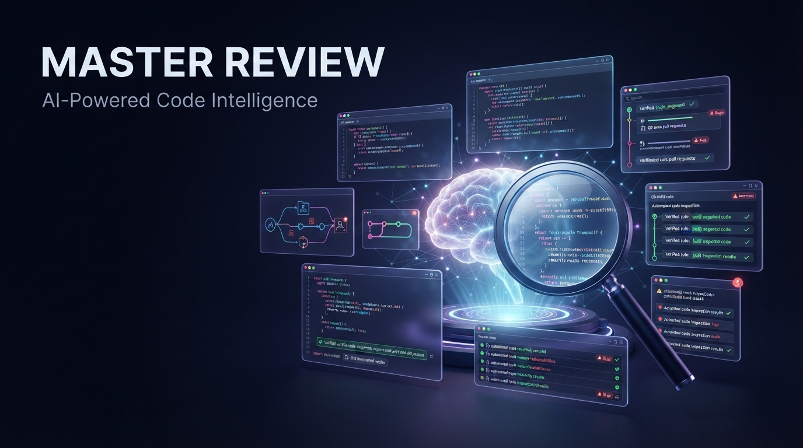

# master-review



[English](README.md) | **Azərbaycanca**

AI kodlaşdırma agentləri üçün kod review skill-ləri. Agentinizə pull request diff-i və ya bütöv
repozitoriya verin; nəticədə real sətirlərə bağlanmış tapıntılardan ibarət Markdown hesabatı
alırsınız. Hər tapıntı adı olan bir qaydaya istinad edir, səbəbini və düzəlişini göstərir.
Skill-lər yalnız hesabat yazır. Onlar heç vaxt şərh paylaşmır, commit və ya push etmir və
yoxlanılan kodu dəyişmir.

| Skill | Nəyi yoxlayır | Nə yazır |
|-|-|-|
| **review-diff** | GitHub PR / GitLab MR diff-i (yapışdırılmış və ya `.diff` faylı) | `review.md`: kopyala-yapışdır şərhlər — klikləniləcək sətir, ciddilik dərəcəsi, qayda və təklif olunan kod |
| **review-change** | PR / MR diff-i **və onun aid olduğu layihə qovluğu** | `review.md`, review-diff kimi, amma agent layihənin qalan hissəsində çağırışları, testləri və konvensiyaları da yoxlayır |
| **review-repo** | bütöv repozitoriya və ya bir alt qovluq: bu repozitoriya və ya yolu verilmiş başqa biri | `repo-review.md`: ümumi baxış, repozitoriya səviyyəsində problemlər (sirlər, testlər, CI, lockfile-lar, struktur), prioritetləşdirilmiş tapıntılar, əhatə |

**Claude Code, OpenAI Codex, GitHub Copilot, Gemini CLI, Cursor və JetBrains Junie** ilə işləyir
(açıq [Agent Skills](https://agentskills.io/specification) formatı). Node.js >= 18 tələb olunur.

## Sürətli başlanğıc

**1. Yoxlamaq istədiyiniz repozitoriyaya quraşdırın**

```bash
git clone https://github.com/dumberbrain/master-review.git
node master-review/scripts/install-skills.mjs --target path/to/your-repo
```

Bu, bütün skill-ləri Claude Code (`.claude/skills/`) və Codex, Copilot, Gemini CLI və Cursor
(`.agents/skills/`) üçün quraşdırır. Digər seçimlər:

- konkret agentlər üçün `--agents claude`, `--agents agents` və ya `--agents claude,junie`;
- `--user` bütün repozitoriyalarınız üçün bir dəfəyə quraşdırır.

Bax: [docs/agents.md](docs/agents.md#installing).

Nəticə fayllarını yoxlanılan repozitoriyanın `.gitignore` faylına əlavə edin:

```gitignore
.review-comment/
review.md
.review-repo/
repo-review.md
repo-review-*.md
.review-change/
```

**2. Pull request-i yoxlayın**

```bash
gh pr diff 42 > pr-42.diff          # və ya https://github.com/<owner>/<repo>/pull/42.diff açın
```

Claude Code-da: `/review-diff pr-42.diff`. Digər agentlərdə: *"Review pr-42.diff with the
review-diff skill"*. `review.md` faylını açın və razı olduğunuz şərhləri PR-a yapışdırın.

Layihə diskinizdədirsə, onun qovluğunu da verin. Belə olduqda agent diff-dən kənardakı
çağırışları və testləri də yoxlaya bilər: `/review-change pr-42.diff ../shop-api`. Bax:
[docs/review-change.md](docs/review-change.md).

**3. Bütöv repozitoriyanı yoxlayın**

Claude Code-da: `/review-repo`, və ya bir qovluq üçün `/review-repo src/api`. Başqa
repozitoriyanı yoxlayıb hesabatı burada saxlamaq üçün: `/review-repo ../shop-api`. Bu əmr
`repo-review-shop-api.md` faylını yazır. Digər agentlərdə: *"Run the review-repo skill on this
repository"* və ya *"…on `../shop-api`"*. Hesabatı açın.

## Sənədlər

Sənədlər ingilis dilindədir.

| Sənəd | Nə üçün oxumalı |
|-|-|
| [docs/overview.md](docs/overview.md) | məqsəd, necə işləyir, qaydalar və ciddilik dərəcələri, məhdudiyyətlər |
| [docs/review-diff.md](docs/review-diff.md) | diff-ləri əldə etmək, işə salmaq, `review.md`-ni oxumaq, GitHub/GitLab-a yapışdırmaq, CLI arayışı, problemlərin həlli |
| [docs/review-change.md](docs/review-change.md) | diff-i layihəsi ilə birlikdə yoxlamaq, head və ya base checkout, context köməkçisi, problemlərin həlli |
| [docs/review-repo.md](docs/review-repo.md) | nə skan olunur, hansı fayllar oxunur, `repo-review.md`-ni oxumaq, sirlər, böyük repozitoriyalar, CLI arayışı, problemlərin həlli |
| [docs/agents.md](docs/agents.md) | dəstəklənən agentlər və onların qovluqları, quraşdırma, hər agentdə işə salma, **portativ skill-lər üçün qaydalar** |
| [docs/rules.md](docs/rules.md) | qayda faylının formatı; qaydaları redaktə etmək, əlavə etmək və ləğv etmək; dil əlavə etmək; faylları ötürmək |
| [docs/development.md](docs/development.md) | repozitoriyanın quruluşu, tək mənbə qaydası, testlər, skill-i dəyişmək və ya əlavə etmək |
| [AGENTS.md](AGENTS.md) | bu repozitoriya üzərində işləyən AI agentləri üçün təlimatlar |

## Necə işləyir

Qərarı agent verir: kodu və qaydaları oxuyur və tapıntıları JSON şəklində yazır. Hər skill-dəki
kiçik Node.js köməkçisi dəqiq olmalı olan hər şeyi edir:

- diff-i təhlil etmək və ya repozitoriyanı skan etmək;
- şərh yazıla bilən sətirləri siyahıya almaq;
- naməlum qaydalara, yanlış dilin qaydalarına və ya mümkün olmayan sətir nömrələrinə istinad
  edən tapıntıları rədd etmək;
- hesabatı yaratmaq.

**Az token, az yalançı tapıntı.** Ucuz işi köməkçi görür ki, model yalnız lazım olanı oxusun:

- review tələb etməyənləri (lock fayllar, generasiya olunmuş fayllar, yalnız whitespace
  dəyişiklikləri) buraxır, qalanlarını riskə görə düzür (auth, injection, secrets, crypto, …);
- model qayda fayllarının tam mətni əvəzinə hər qayda üçün bir sətirlik indeks alır, qaydanın
  tam səbəbini və həllini yalnız ona istinad edəndə soruşur;
- patch-lər hər şərh yazıla bilən sətrin nömrəsi ilə adi mətn kimi verilir: tokenlər nə
  escape olunmuş JSON-a, nə də sətir nömrələrini hesablamağa gedir;
- hər tapıntının əminlik dərəcəsi var; az əmin tapıntılar və üçdən artıq kiçik təklif
  hesabata düşmür.

16 fayllıq TypeScript/React pull request-də agentin oxuduğu həcm iki dəfə azalır (təxminən
27k → 14k token). Öz diff-inizi ölçmək üçün: `npm run bench -- <file.diff>`.

Ətraflı: [docs/overview.md](docs/overview.md#how-it-works).

## Qaydalar

Qaydalar komandanızın redaktə edə biləcəyi Markdown fayllarıdır:

- ümumi qaydalar (`GEN`);
- C# (`CS`), Go (`GO`), Java (`JAVA`), JavaScript (`JS`), TypeScript (`TS`), React (`REACT`);
- repozitoriya səviyyəsində qaydalar (`REPO`).

Hər tapıntı dəqiq bir qaydaya istinad edir. Bax: [docs/rules.md](docs/rules.md).

## Bu repozitoriyanın inkişafı

```bash
npm run sync    # .claude/skills/ altında hər hansı dəyişiklikdən sonra
npm test        # test runner üçün Node.js >= 22
```

Skill-ləri yalnız `.claude/skills/` altında redaktə edin. `.agents/skills/` və `.junie/skills/`
avtomatik yaradılır. Bax: [docs/development.md](docs/development.md).
